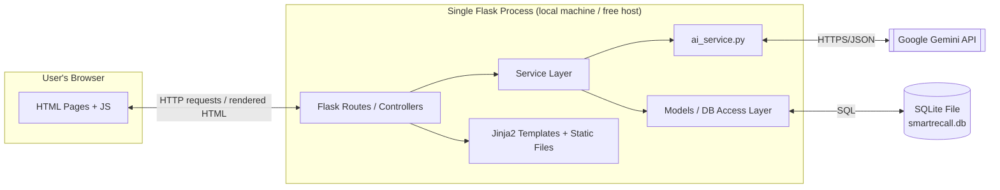

# SmartRecall — Architecture

CSCI 4397 / CSCI 6397: Software Engineering and AI
University of Central Arkansas, Fall 2026
Team: Yasir Nawaz, Moustapha Fofana, Alex Du

## 1. High-Level Diagram

There is **one running process**: a single Flask application. It renders pages, exposes JSON endpoints for the interactive quiz features, and talks to SQLite and Gemini internally. There is no separate frontend server and no microservices.

## 2. Backend

**Structure: monolithic, not microservices.**
For a team of three working over roughly ten weeks, a single Flask application is far easier to develop, test, and deploy than splitting the app into separate services communicating over a network. A microservice split (e.g., a separate "AI service" and "flashcard service") would add deployment complexity, inter-service networking, and failure handling that is not justified by the app's scale. Internally, however, the monolith is organized into layers so it *behaves* like it's modular, even though it deploys as one unit:

- **Routes/Controllers** — receive HTTP requests, handle input validation, call services, return rendered templates or JSON.
- **Services** — business logic (deck management, spaced-repetition scheduling, the AI wrapper). Routes never call the AI API or the database directly; they always go through this layer.
- **Models** — thin data-access layer around SQLite (queries, inserts, updates).

**Hosting.** During development, the app runs locally (`flask run`). For the class demo/deployment milestone, we plan to deploy to a free-tier PaaS host such as **Render** or **PythonAnywhere**, both of which can run a Flask app directly from a GitHub repo without needing to manage a VM.

**Containers.** We will containerize with a single `Dockerfile` for the Flask app. This isn't strictly required for a project this size, but it makes the "works on my machine" problem go away across three teammates and makes deployment to Render/Railway a copy-paste step rather than a platform-specific setup.

**Security.** Given the size and audience of this project, security is deliberately lightweight but not absent:
- The Gemini API key and Flask `SECRET_KEY` are stored in environment variables (via a `.env` file, excluded from Git via `.gitignore`), never hardcoded or committed.
- All user-supplied text sent to Gemini is length-capped and sanitized before being included in a prompt, to reduce prompt-injection risk from pasted content.
- If we implement the optional multi-user/login feature, passwords will be hashed with `werkzeug.security` (Flask's built-in helper) rather than stored in plaintext.
- No sensitive personal data is collected, so there is no additional compliance surface (no payment info, no health data, etc.).

## 3. Database

**Choice:** SQLite, file-based.

**Hosting:** The `.db` file lives on the same filesystem as the Flask app. Locally, that's each teammate's machine during development. In the deployed environment (Render/PythonAnywhere), it lives on that platform's persistent disk. SQLite is a deliberate simplicity trade-off for a class project: it needs no separate database server, no connection pooling, and no network hop between the app and the data.

**Mirroring/backup:** No live replication is planned; that's overkill for this project's scale and would require infrastructure we don't need. Instead:
- The schema (`schema.sql`) is committed to Git, so the database structure can be recreated from scratch at any time.
- A small `seed_data.sql` / export script lets us dump sample data for reproducible demos and for teammates to reset a corrupted local database quickly.
- Before each milestone demo, we take a manual snapshot copy of the `.db` file as a lightweight backup.

**Logging:** Python's built-in `logging` module writes to a rotating log file (`app.log`), capturing: incoming requests, Gemini API calls (prompt metadata, not full user content, to avoid bloating logs), errors/exceptions, and database write operations. This gives us a debugging trail without needing an external logging service.

## 4. AI Integration (Google Gemini API)

**Where it's integrated:** At the **service layer**, in a dedicated `ai_service.py` module. Routes never call the Gemini API directly — they call functions like `ai_service.generate_flashcards(text)` or `ai_service.grade_short_answer(question, reference_answer, user_answer)`. This keeps the AI calls isolated, swappable (we could switch to a different model provider later by only changing this one file), and easy to unit test with mocked responses.

**What level it operates at:**
- **Generation time only** — Gemini is called synchronously when a user submits text to generate a new study set, or when a user submits a short-answer response for grading. It is not called on every page load or on a background schedule.
- The service layer sends a structured prompt (with an explicit instruction to return JSON) and parses the response into our internal data model (question, answer/options, type, difficulty tag) before it ever reaches the database or the UI.
- All AI output is treated as **untrusted input to be validated**, not as ground truth: the service layer checks that the response is well-formed JSON with the expected fields before saving it, and a human teammate spot-checks generated content per our team's working agreement in the proposal.

## 5. Frontend

**Decision:** Server-rendered HTML/CSS/JavaScript using Flask's built-in Jinja2 templating — no separate frontend framework (React/Vue) and no separate frontend server.

**How this fits with the Flask services:** There is no second server. The same Flask process that handles our backend routes also renders the HTML pages and serves static assets (CSS/JS). Concretely:
- Flask's `template_folder` and `static_folder` are pointed at a top-level `frontend/` directory, so the frontend code is organized and version-controlled separately from backend logic even though it executes inside the same process.
- Routes that render full pages (e.g., viewing a deck) return a rendered Jinja2 template.
- Routes that back interactive UI behavior (flipping a card, submitting a quiz answer, grading a short answer) return small JSON responses, which a small amount of vanilla JavaScript in `frontend/static/js/app.js` consumes via `fetch()` calls and uses to update the page without a full reload.

This means the "frontend" is a real, separately organized part of the codebase — it is just not a separately *running* process. We chose this over a React/Flask-API split specifically to reduce moving parts for a three-person team on a ten-week timeline: no build step, no CORS configuration, no separate deployment target for the UI.

## 6. Summary of Trade-offs

| Decision | Why | Trade-off accepted |
|---|---|---|
| Monolithic Flask app | Simplicity for small team/timeline | Less horizontal scalability (not needed here) |
| SQLite | Zero-config, file-based | No built-in replication/concurrency at scale |
| AI called at service layer only | Testability, isolation, provider-swappable | Slightly more boilerplate than calling Gemini directly in routes |
| Server-rendered frontend | No build tooling, no separate server/deploy target | Less componentized, harder to reuse UI pieces than React |
